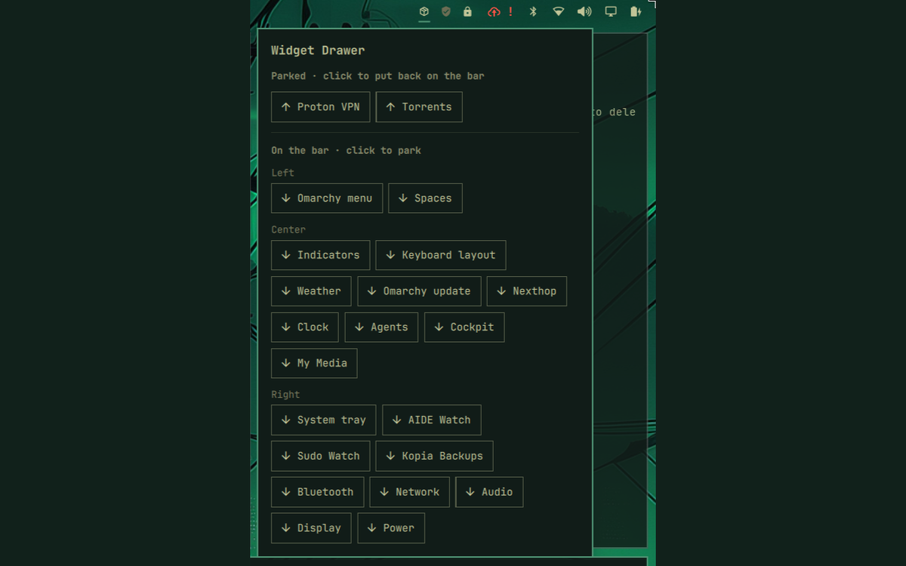
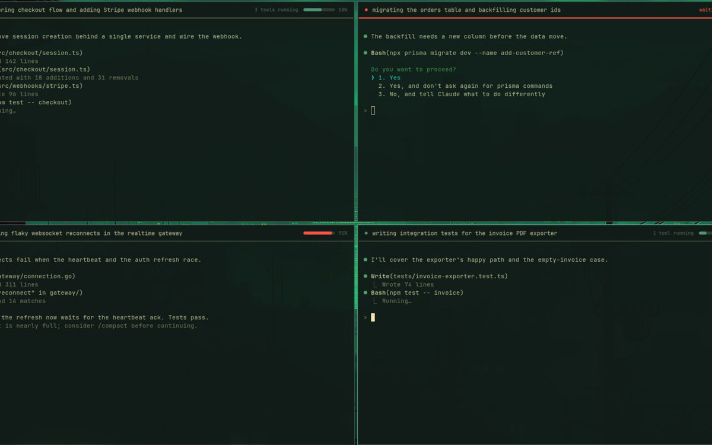
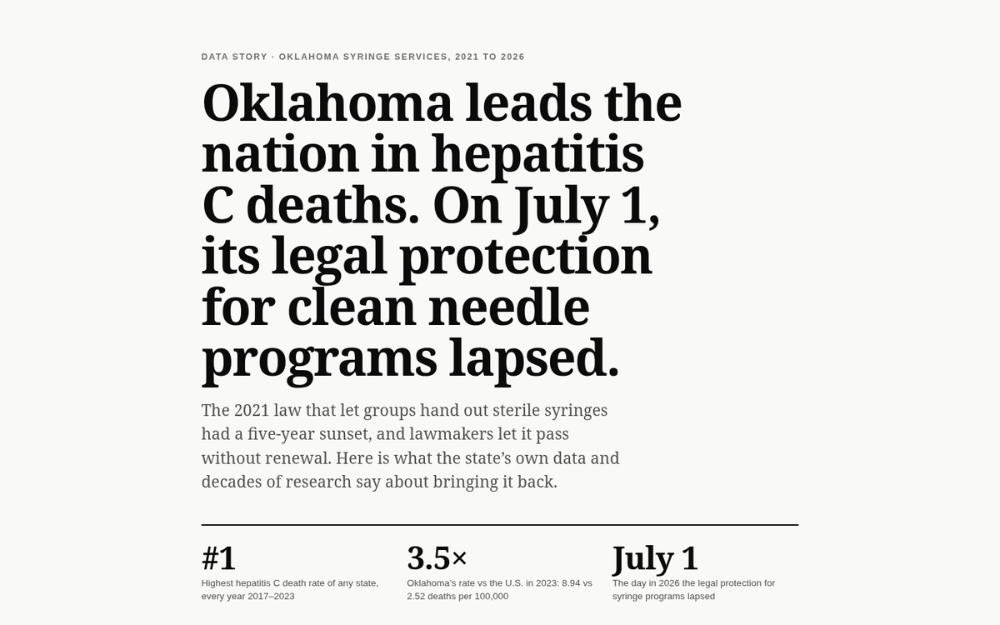
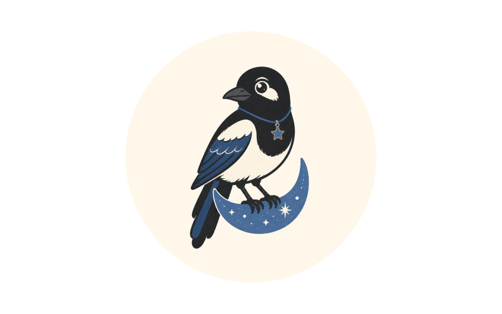

Typescript focused multi-disciplinary coder. Interested in data, security, and ux. Check out my [dev blog](https://www.taylorburke.me/)

## Omarchy plugins

<table>
  <tr>
    <td width="50%" valign="top">
      
      <h3><a href="https://github.com/TaylorBurke/widget-drawer">Widget Drawer</a></h3>
      Park unused bar widgets behind one icon instead of uninstalling them. 
      <a href="https://plugins.omarchy.org/plugin.html?id=taylorburke.widget-drawer">Omarchy Plugin Marketplace →</a>
    </td>
    <td width="50%" valign="top">
      
      <h3><a href="https://github.com/TaylorBurke/claude-strip">claude-strip</a></h3>
      A per-window Claude Code session strip: project, task and running tools at the top of each terminal. 
      <a href="https://plugins.omarchy.org/plugin.html?id=taylorburke.claude-strip">Omarchy Plugin Marketplace →</a>
    </td>
  </tr>
</table>

## Data analysis

<table>
  <tr>
    <td width="50%" valign="top">
      
      <h3><a href="https://taylorburke.github.io/ok-syringe-access/">Clean Needles, Oklahoma</a></h3>
      A data story on restoring Oklahoma's syringe services law, which expired July 1, 2026. 
      <a href="https://github.com/TaylorBurke/ok-syringe-access">Source and methodology →</a>
    </td>
    <td width="50%" valign="top">
      
      <h3><a href="https://filchy.com">Filchy</a></h3>
      A tarot reading that talks back. Draw a card, hear what Filchy sees in it, and answer in your own words. 
      <a href="https://filchy.com">Coming to Android in November →</a>
    </td>
  </tr>
</table>
